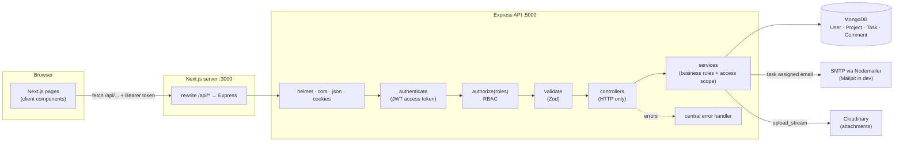
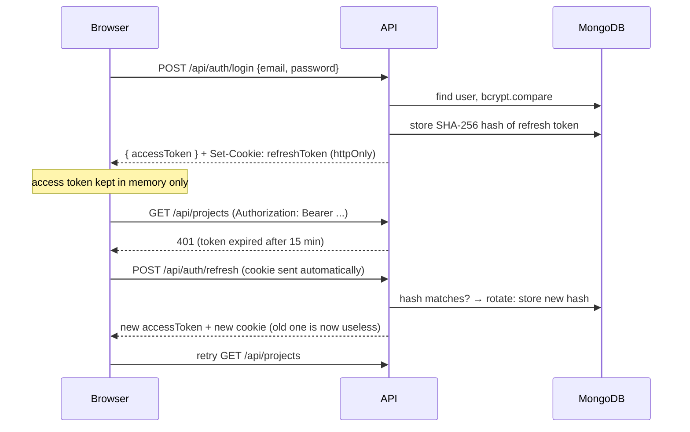

# Client Project & Task Portal

A portal where an agency manages client projects and tasks and clients follow their progress.

- **Backend:** Node.js, Express 5, MongoDB (Mongoose), TypeScript
- **Frontend:** Next.js 16 (App Router), React 19, TypeScript, plain CSS

**Roles**

| Role | What they do |
| --- | --- |
| Admin | Everything, including deleting projects and creating users |
| Manager | Creates and edits projects and tasks |
| Developer | Works on assigned tasks (moves them across the board, uploads files) |
| Client | Reads their own projects and comments on tasks |

---

## Architecture



### Login and token refresh



### Folder structure

```
task_portal/
├── backend/
│   ├── src/
│   │   ├── config/        env.ts (all env vars), db.ts
│   │   ├── models/        User, Project, Task, Comment (+ indexes)
│   │   ├── middleware/    auth (authenticate/authorize), validate, upload, errorHandler
│   │   ├── validators/    Zod schemas (+ inferred TS types)
│   │   ├── controllers/   req/res only
│   │   ├── services/      business logic, access rules, email, Cloudinary
│   │   ├── routes/        URL → middleware → controller
│   │   ├── docs/          openapi.ts (Swagger spec)
│   │   ├── utils/         AppError, tokens, pagination
│   │   ├── app.ts         builds the Express app (used by tests)
│   │   ├── server.ts      connects to Mongo and listens
│   │   └── seed.ts        demo data
│   └── tests/             Jest + Supertest (in-memory MongoDB)
├── frontend/
│   └── src/
│       ├── app/           Next.js routes (login, (portal)/dashboard, projects, tasks)
│       ├── components/    ui/ (Button, Input, Modal, Table, Badge, Pagination, Loader,
│       │                  EmptyState, ErrorMessage) + feature components + __tests__/
│       ├── context/       AuthContext (session restore, login, logout)
│       ├── hooks/         useApi (loading / error / reload)
│       └── lib/           api client, types, permissions, validation, formatting
├── docker-compose.yml     local dev: mongo + mailpit + backend + frontend
└── .github/workflows/ci.yml
```

---

## Getting started

### Option A: Docker (recommended)

```bash
cp backend/.env.example backend/.env   # optional: only needed for Cloudinary keys
docker compose up --build
docker compose exec backend npm run seed
```

| URL | What |
| --- | --- |
| http://localhost:3000 | Frontend |
| http://localhost:5000/api-docs | Swagger UI |
| http://localhost:5000/health | Health check |
| http://localhost:8025 | Mailpit inbox (shows the "task assigned" emails) |

### Option B: Run locally

Requires Node 22+ and a running MongoDB.

```bash
# API
cd backend
cp .env.example .env        # set MONGO_URI if needed
npm install
npm run seed                # demo users, projects, tasks
npm run dev                 # http://localhost:5000

# Web (second terminal)
cd frontend
cp .env.example .env.local  # API_URL=http://localhost:5000
npm install
npm run dev                 # http://localhost:3000
```

### Demo accounts

Every account's password is `Password123!`.

| Email | Role |
| --- | --- |
| admin@demo.com | admin |
| manager@demo.com | manager |
| dev@demo.com, dev2@demo.com | developer |
| client@demo.com, client2@demo.com | client |

### Tests

```bash
cd backend  && npm test   # 57 Jest + Supertest tests (auth, RBAC, tasks, comments, uploads, email)
cd frontend && npm test   # 15 Vitest + React Testing Library tests (Button, Modal, Pagination, Input)
```

The backend tests start an **in-memory MongoDB**, so you don't need a database. The first run downloads a MongoDB binary (~100 MB).

### Environment variables (backend)

| Variable | Purpose | Default |
| --- | --- | --- |
| `MONGO_URI` | MongoDB connection | `mongodb://localhost:27017/task_portal` |
| `PORT` | API port | `5000` |
| `CLIENT_URL` | Frontend origin (CORS, links in emails) | `http://localhost:3000` |
| `JWT_ACCESS_SECRET` / `JWT_REFRESH_SECRET` | Token signing keys. **Required in production** | dev values |
| `JWT_ACCESS_EXPIRES_IN` / `JWT_REFRESH_EXPIRES_IN` | Token lifetimes | `15m` / `7d` |
| `SMTP_HOST`, `SMTP_PORT`, `SMTP_USER`, `SMTP_PASS`, `EMAIL_FROM` | Nodemailer. If `SMTP_HOST` is empty, emails are only logged | empty |
| `CLOUDINARY_CLOUD_NAME`, `CLOUDINARY_API_KEY`, `CLOUDINARY_API_SECRET` | Attachments. If empty, uploads return 503 | empty |

The frontend needs only `API_URL`, the address Next.js forwards `/api/*` to.

---

## API overview

The full interactive docs are at **`/api-docs`** (Swagger).

- Every response is `{ data }` or `{ data, pagination }`.
- Every error is `{ error: { message, details? } }`.

| Method | Path | Who | Notes |
| --- | --- | --- | --- |
| POST | `/api/auth/login` | public | Returns `accessToken`, sets the `refreshToken` cookie |
| POST | `/api/auth/refresh` | cookie | Rotates the refresh token |
| POST | `/api/auth/logout` | cookie | Revokes the refresh token |
| GET | `/api/auth/me` | logged in | Current user |
| GET | `/api/users` | admin, manager | `?role=&search=&page=&limit=` |
| POST | `/api/users` | admin | Create a user |
| GET | `/api/projects` | all | Scoped to the user. `?status=&search=&page=&limit=` |
| GET | `/api/projects/:id` | all (scoped) | Out-of-scope projects return 404 |
| POST / PATCH | `/api/projects[/:id]` | admin, manager | |
| DELETE | `/api/projects/:id` | admin | Also deletes the project's tasks and comments |
| GET | `/api/tasks` | all (scoped) | `?project=&assignee=<id\|me>&status=&priority=&search=&page=&limit=` |
| GET | `/api/tasks/stats` | all (scoped) | Counts by status, for the dashboard |
| GET | `/api/tasks/:id` | all (scoped) | |
| POST | `/api/tasks` | admin, manager | Emails the assignee |
| PATCH | `/api/tasks/:id` | admin, manager, developer* | *Developers: only their own tasks, only `status` |
| DELETE | `/api/tasks/:id` | admin, manager | |
| POST | `/api/tasks/:id/attachments` | admin, manager, assigned developer | `multipart/form-data`, field `file`, max 5 MB |
| DELETE | `/api/tasks/:id/attachments/:attachmentId` | same as above | |
| GET / POST | `/api/tasks/:taskId/comments` | anyone who can see the task | Clients can comment too |
| GET | `/health` | public | 200 if the DB is connected, 503 if not |

### Permission matrix

| Action | Admin | Manager | Developer | Client |
| --- | :-: | :-: | :-: | :-: |
| See projects | all | all | where member | own only |
| Create / edit project | ✅ | ✅ | ❌ | ❌ |
| Delete project | ✅ | ❌ | ❌ | ❌ |
| Create / edit / delete task | ✅ | ✅ | ❌ | ❌ |
| Change task status | ✅ | ✅ | own tasks | ❌ |
| Upload attachments | ✅ | ✅ | own tasks | ❌ |
| Comment | ✅ | ✅ | ✅ | ✅ (own projects) |
| Create users | ✅ | ❌ | ❌ | ❌ |

---

## Design decisions

**Controller → service structure.** Routes only wire middleware together. Controllers only read `req` and write `res`. Services hold the business rules and know nothing about HTTP. That keeps every file small, and the rules are easy to find and test.

**RBAC in two layers.**
1. `authorize('admin', 'manager')` on the route answers "may this *role* call this endpoint at all?"
2. Services answer "may this *user* touch this *record*?" For example: a developer updating a task must be its assignee and may only change `status`.

All "who can see which project" logic is in **one function**, `projectScope(user)` in `access.service.ts`. It returns a Mongo filter (`{ client: me }`, `{ members: me }` or `{}`) that every project, task and comment query uses. A new endpoint can't forget the rule.

**404 instead of 403 for other people's data.** If client A asks for client B's project, the API says "not found". That way it doesn't confirm the project exists.

**JWT access and refresh tokens.**
- The **access token** lasts 15 minutes and is kept only in JavaScript memory, never in localStorage, so an XSS attack can't steal a long-lived token. It is stateless, so no DB lookup is needed per request.
- The **refresh token** lasts 7 days and lives in an **httpOnly, SameSite=strict cookie** scoped to `/api/auth`. JavaScript can't read it, and other sites can't make the browser send it.
- The database stores only a **SHA-256 hash** of the refresh token. Each refresh **rotates** it, so a stolen, already-used token is useless. Logout deletes the hash.
- Trade-off: a deleted user's access token keeps working for up to 15 minutes. That's the usual price of stateless tokens, kept small by the short lifetime.

**Passwords.** Passwords are hashed with bcrypt in a Mongoose `pre('save')` hook, so no code path can save a plain password. The field is `select: false`, and `toJSON` strips it from every response. Login uses one error message for "unknown email" and "wrong password", so attackers can't check which emails exist. Login is also rate-limited (20 tries per 15 minutes per IP).

**Validation with Zod.** Each schema is the single source of truth: it validates the request *and* gives a TypeScript type via `z.infer`. The `validate()` middleware turns Zod errors into `400 { details: [{ field, message }] }`, and the frontend maps those back onto form fields.

**Centralized error handling.** Code throws `new AppError(status, message)`, and Express 5 forwards errors from async handlers on its own. A single `errorHandler` turns known library errors into clean responses:
- invalid ObjectId → 400
- duplicate email → 409
- bad JWT → 401
- file too large → 400

Unknown errors become a generic 500 and are logged, without leaking internals.

**Indexes match the queries.**
- `Task`: `{project, status}` for the board and `{assignee, status}` for "my tasks".
- `Project`: `{client}` and `{members}`, the access-scope filters.
- `Comment`: `{task, createdAt}`, so a task's comments come back in order.
- `User`: unique `{email}`.

**Pagination and search.** Every list returns `{ data, pagination }`, and `limit` is capped at 100. Search is a case-insensitive regex with the user's input **escaped**, to prevent regex injection. At this size, a regex search is simpler than a text index and supports partial words.

**Email never breaks a request.** If SMTP is down, the task is still created and the error is logged. When `SMTP_HOST` is empty, and always in tests, Nodemailer uses its built-in `jsonTransport`, a mock transport that builds the email without sending it. Tests use `jest.spyOn` to check that the email was triggered.

**Uploads.** Multer keeps the file in memory (5 MB limit, whitelist of file types) and streams it straight to Cloudinary, so nothing is written to the server's disk. That keeps the API stateless and easy to scale. Uploads return 503 when Cloudinary isn't configured, and tests mock the upload service.

**`app.ts` vs `server.ts`.** `app.ts` builds the Express app without connecting to anything, so Supertest can import it directly. `server.ts` connects to MongoDB and listens.

**Next.js as the frontend.**
- The App Router's file-based routes replace React Router.
- A route group `(portal)` shares one layout, so the login guard and navigation are written once.
- Pages are **client components**: data is per-user and the access token lives in browser memory, so server rendering couldn't fetch it.
- A Next.js **rewrite** proxies `/api/*` to Express. The browser sees one origin, so no CORS is needed and the `SameSite=strict` cookie just works.

**Concurrent refresh is single-flight.** Refresh tokens are single-use, so if two requests got a 401 at the same moment and both called `/refresh`, the second call would fail and log the user out. The API client shares one in-flight refresh promise between them.

**UI hides what a role can't do.** `lib/permissions.ts` mirrors the backend rules, so for example a client never sees an "Edit" button. The backend still enforces everything; the UI checks are only for user experience.

**Testing.**
- Backend tests run against a real (in-memory) MongoDB, so queries, indexes and populate calls are exercised for real rather than mocked.
- In tests, bcrypt uses 4 rounds (10 in production), so the suite runs in about 15 seconds.
- Frontend tests use React Testing Library and query by role and label, the way a user or screen reader finds things.

### Known limits / next steps

- The task board loads up to 100 tasks. A very large project would need per-column pagination.
- There's no user management screen in the UI yet. Users are created through `POST /api/users` (admin) or the seed script.
- Access tokens aren't revocable before they expire (stateless by design).
